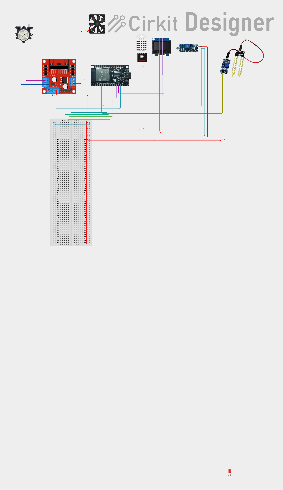

# ESP32-Based Smart Plant Monitoring and Irrigation System

An open-hardware IoT platform designed to monitor environmental growth parameters, automate soil irrigation and ventilation, and provide local and cloud-based telemetry for small-scale agriculture.

---

## Team Members

- **Abdalrahim**
- **Khalid Abdillahi**
- **Yousuf**

---

## Project Overview

Agriculture is the primary livelihood for many families and smallholder farmers across Sub-Saharan Africa. However, small-scale farming often faces serious obstacles, including unpredictable weather variations, improper irrigation practices, and a lack of accessible tools to monitor crop conditions in real time. 

Commercial agricultural automation systems are typically expensive and designed for large industrial facilities rather than smallholder farms or community greenhouses. 

This project explores how affordable, accessible Internet of Things (IoT) technology can bridge that gap. Built around an **ESP32 microcontroller**, the system continuously monitors soil moisture, ambient temperature, relative humidity, and light levels, automatically triggering irrigation and cooling actuators while transmitting telemetry to both local and cloud dashboards.

---

## Circuit Diagram

Below is the hardware wiring diagram showing the connections between the ESP32, sensors, L298N motor driver, and actuators:



---

## Main Hardware Components

- **ESP32 Microcontroller:** Core unit providing dual-core processing, analog-to-digital conversion, and Wi-Fi connectivity.
- **Soil-Moisture Sensor:** Analog probe measuring continuous soil moisture levels.
- **DHT22 Sensor:** Digital sensor measuring ambient air temperature and relative humidity.
- **LDR Light Sensor Module:** Analog photoresistor measuring illumination levels.
- **SH1106 OLED Display (128×64):** I2C screen providing immediate on-device readings.
- **L298N Motor Driver:** Dual H-bridge driver handling DC power switching for the pump and fan.
- **Peristaltic Water Pump:** Precise, non-backflow pump for automated soil watering.
- **DC Ventilation Fan:** Airflow fan for active temperature regulation.
- **Darkness Indicator LEDs:** Supplementary lighting automatically triggered during low-light conditions.
- **Prototyping Board & Wiring:** Solderless breadboard and jumper connections.

---

## Firmware Features

The firmware ([firmware/esp32_smart_plant/esp32_smart_plant.ino](firmware/esp32_smart_plant/esp32_smart_plant.ino)) is written in C++ for the Arduino framework. Key functions include:

1. **Continuous Soil Evaluation:** Calculates moisture as a continuous 0–100% percentage using calibrated wet and dry analog endpoints.
2. **Automated Irrigation:** Turns the water pump **ON** when soil moisture drops to $\le 60\%$, and turns it **OFF** once moisture reaches $\ge 100\%$.
3. **Temperature Control:** Operates the ventilation fan in two selectable modes:
   - *Automatic Mode:* Fan turns **ON** when temperature exceeds $28.0^\circ\text{C}$.
   - *Manual Mode:* User can manually force the fan ON or OFF from the web dashboard.
4. **Light Level Smoothing & Hysteresis:** Averages 10 analog LDR samples to filter rapid light fluctuations. LEDs turn ON when light drops $\le 20\%$ and turn OFF when light rises $\ge 30\%$ to prevent flickering.
5. **Local OLED Display:** Updates every 2 seconds via the U8g2 library with all live sensor values and actuator states.
6. **Embedded Web Dashboard:** Built-in HTTP server on port 80 serving an asynchronous web dashboard and a JSON endpoint (`/data`) for local Wi-Fi monitoring and manual fan control.

---

## Cloud Connectivity

The system integrates two separate cloud communication pipelines:

- **ThingSpeak (HTTP API):** Transmits temperature, humidity, soil moisture, and light intensity every 20 seconds for cloud charting and visual trends.
- **HiveMQ Cloud (MQTT over TLS):** Establishes a secure connection on port 8883 (using NTP time sync for certificate validation) and publishes individual topic telemetry for temperature, humidity, soil moisture, light, pump status, fan status, and connection health.

---

## Project Demonstration Video

A video demonstrating the hardware setup, sensor operation, and web interface is available here:

- **Google Drive Demonstration Link:** [Watch Project Demonstration](https://drive.google.com/your-drive-link-here)  
  *(Replace with your team's Google Drive sharing link)*

---

## Current Development Status

- [x] **Firmware Implementation:** Complete source code handling sensing, local display, web interface, and dual cloud transmission.
- [x] **Circuit Integration:** Microcontroller, sensor network, motor driver, and actuators wired on a breadboard.
- [x] **Local Monitoring:** OLED display and embedded web dashboard operational over local Wi-Fi.
- [x] **Credential Separation:** Clean repository architecture separating private credentials into an untracked header file.
- [ ] **Field Testing:** Extended endurance and multi-soil testing are currently in progress.

---

## Repository Structure

```text
smart-plant-iot/
│
├── README.md                          # Project overview and quick start guide
│
├── firmware/
│   └── esp32_smart_plant/
│       ├── esp32_smart_plant.ino      # Main Arduino ESP32 firmware
│       └── secrets.h.example          # Template for Wi-Fi and cloud credentials
│
├── images/
│   └── circuit-diagram.png            # Original project circuit diagram
│
├── docs/
│   └── project-progress-report.md     # Detailed academic progress report
│
└── .gitignore                         # Protects build files and private credentials
```

---

## Getting Started

1. **Clone the repository:**
   ```bash
   git clone https://github.com/your-username/smart-plant-iot.git
   cd smart-plant-iot
   ```

2. **Configure Credentials:**
   - Navigate to `firmware/esp32_smart_plant/`.
   - Copy `secrets.h.example` to `secrets.h`:
     ```bash
     cp secrets.h.example secrets.h
     ```
   - Open `secrets.h` and fill in your Wi-Fi SSID, password, ThingSpeak API key, and HiveMQ Cloud credentials.
   *(Note: `secrets.h` is ignored by `.gitignore` and will never be committed to Git).*

3. **Install Arduino Libraries:**
   Ensure the following libraries are installed in your Arduino IDE:
   - `DHT sensor library` (Adafruit)
   - `U8g2` (olikraus)
   - `PubSubClient` (Nick O'Leary)

4. **Upload Firmware:**
   - Connect the ESP32 via USB.
   - Select your ESP32 board and COM port in Arduino IDE.
   - Upload `esp32_smart_plant.ino`.
   - Open Serial Monitor at **115200 baud** to view IP address and initialization logs.

---

## Detailed Project Report

For a complete technical breakdown including the problem statement, system architecture, pin assignments, and future engineering milestones, please refer to the [Project Progress Report](docs/project-progress-report.md).
