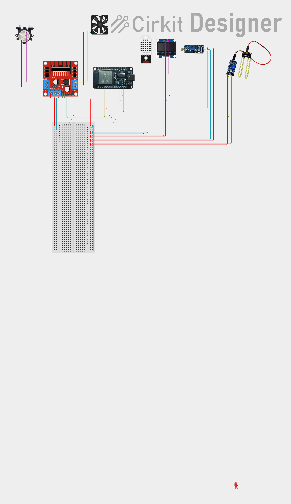

# Project Progress Report: ESP32-Based Smart Plant Monitoring and Irrigation System

**Project Category:** Internet of Things (IoT) – Smart Agriculture  
**Document Type:** Project Progress and System Documentation  
**Target Submission:** Faculty Review & Future Engineering Research  

---

## 1. Team Information

- **Abdalrahim**
- **Khalid Abdillahi**
- **Yousuf**

---

## 2. Introduction

Agriculture remains the cornerstone of food security, community resilience, and economic livelihood across the globe. Recent developments in open hardware and embedded networking have made Internet of Things (IoT) solutions increasingly accessible. 

This project presents an **ESP32-Based Smart Plant Monitoring and Irrigation System**, designed to monitor critical plant growth parameters and automate environmental controls such as soil watering, ventilation, and supplementary lighting. The system integrates low-cost sensing, local user feedback, embedded web controls, and cloud connectivity to explore practical, accessible IoT solutions for small-scale cultivation.

---

## 3. Background and Problem Statement

Our team originates from Sub-Saharan Africa, where millions of families and smallholder farmers depend on agriculture for their daily livelihoods. In these regions, small-scale farming faces significant operational challenges:

- **Unpredictable Environmental Conditions:** Fluctuating ambient temperatures and changing sunlight patterns directly affect plant health.
- **Irrigation Management:** Water is often a scarce or labor-intensive resource. Over-watering leaches nutrients and wastes water, while under-watering leads to crop failure.
- **Lack of Real-Time Information:** Most family farmers rely solely on visual inspection and manual estimation, making it difficult to detect moisture stress or unfavorable temperatures before visible damage occurs.
- **High Cost of Commercial Systems:** Industrial agricultural automation systems are prohibitively expensive and engineered for large-scale operations rather than family plots or small greenhouses.

There is a clear need for an affordable, transparent, and adaptable monitoring platform that can assist growers in maintaining healthy growing environments without requiring high capital investment.

---

## 4. Project Objectives

1. **Environmental Sensing:** Collect real-time measurements of soil moisture, ambient temperature, relative humidity, and ambient light intensity.
2. **Automated Actuation:** Implement local, threshold-based automated control for:
   - Soil irrigation using a peristaltic water pump.
   - Temperature regulation using a DC ventilation fan.
   - Darkness compensation using indicator LEDs.
3. **Local User Interaction:** Provide instant on-device feedback through an OLED screen and a local Wi-Fi web dashboard accessible from mobile phones and local computers.
4. **Cloud Telemetry:** Transmit periodic sensor readings and actuator operational states to cloud services (ThingSpeak and HiveMQ Cloud MQTT over TLS) for remote logging and potential remote monitoring.
5. **System Modularity:** Maintain an accessible hardware and firmware structure that can serve as a foundation for further engineering research and crop-specific adaptation.

---

## 5. Project Scope

### In Scope
- Development and integration of an ESP32-centered embedded prototype.
- Sensor interfacing for analog soil moisture, digital DHT22 temperature/humidity, and analog LDR ambient light.
- Driver interfacing via an L298N dual H-bridge motor driver to run a DC fan and a peristaltic water pump.
- Local display output via I2C for an SH1106 OLED module.
- On-chip HTTP web server providing real-time data streaming and manual/automatic control modes.
- Wi-Fi network connectivity with HTTP-based ThingSpeak cloud updates and secure MQTTS telemetry via HiveMQ Cloud.

### Out of Scope (Current Phase)
- Industrial-grade weatherproofing or outdoor agricultural enclosure deployment.
- Long-distance wireless protocols (such as LoRa or cellular GSM/NB-IoT).
- Commercial-scale power management (solar charging or battery deep-sleep cycling).
- Crop-specific automated machine learning prediction models.

---

## 6. Hardware Components

The physical prototype is constructed using the following components:

| Component | Description & Role |
| :--- | :--- |
| **ESP32 Microcontroller** | Core processing and communication unit (built-in Wi-Fi and dual-core 32-bit MCU). |
| **Soil-Moisture Sensor** | Analog probe inserted into the soil substrate to measure relative moisture levels. |
| **DHT22 Sensor** | Digital sensor providing calibrated ambient temperature (°C) and relative humidity (%) readings. |
| **LDR Module** | Light Dependent Resistor module reading ambient illumination levels. |
| **SH1106 OLED Display (128×64)** | Monochrome 1.3-inch screen utilizing I2C communication for on-device status output. |
| **L298N Motor Driver** | Dual H-bridge driver module providing external DC power switching to inductive loads. |
| **DC Fan** | 12V/5V DC ventilation fan for localized air circulation and heat reduction. |
| **Peristaltic Water Pump** | DC fluid pump providing controlled, accurate water delivery without backflow. |
| **LED Indicators** | Low-light supplementary illumination and status indicators. |
| **Prototyping Hardware** | Solderless breadboard, regulated power lines, and jumper wiring. |

---

## 7. Circuit Diagram

The electrical connections between the ESP32 microcontroller, sensors, driver module, and actuators are shown in the official circuit diagram below:

### Hardware Pin Mapping (as defined in firmware)

- **DHT22 Data:** GPIO 18
- **Soil Moisture Analog Input:** GPIO 34 (ADC1_CH6)
- **LDR Analog Input:** GPIO 35 (ADC1_CH7)
- **SH1106 OLED (I2C):** GPIO 21 (SDA), GPIO 22 (SCL)
- **L298N Fan Controls:** GPIO 33 (`FAN_IN1`), GPIO 25 (`FAN_IN2`)
- **L298N Pump Controls:** GPIO 26 (`PUMP_IN3`), GPIO 27 (`PUMP_IN4`)
- **Darkness Indicator LEDs:** GPIO 12 (`LED1`), GPIO 13 (`LED2`)

---

## 8. Software and IoT Architecture

The software is structured as a single integrated Arduino C++ firmware executed on the ESP32. It balances local real-time sensing, closed-loop actuator control, and cloud telemetry.

### 8.1 Continuous Sensor Processing
- **Soil Moisture Calculation:** Rather than discrete multi-step thresholds, the firmware computes continuous percentage values derived from the calibrated raw analog reading:
  - Dry reference (`SOIL_DRY_VALUE`): `3840` (corresponds to 0%)
  - Wet reference (`SOIL_WET_VALUE`): `1669` (corresponds to 100%)
  - Result is constrained strictly between 0% and 100%.
- **Light Level Filtering:** To prevent erratic switching from sudden cloud movement or transient shadows, the LDR input takes an average of 10 samples before mapping to a 0–100% light index.
- **Hysteresis Lighting Control:** The indicator LEDs turn ON when light drops to $\le 20\%$ and turn OFF when light rises to $\ge 30\%$, creating a stable deadband that eliminates flickering.

### 8.2 Actuator Decision Logic
- **Water Pump Control:** Fully automatic based on soil moisture:
  - Turns **ON** when soil moisture drops to $\le 60\%$.
  - Turns **OFF** when soil moisture reaches $\ge 100\%$.
- **Ventilation Fan Control:** Supports dual modes:
  - **Automatic Mode:** Turns **ON** when temperature exceeds $28.0^\circ\text{C}$; turns **OFF** when temperature is within acceptable limits.
  - **Manual Mode:** Override states (**ON** or **OFF**) triggered directly by the user via the local web dashboard.

### 8.3 Local User Interface
- **OLED Display:** Updates every 2 seconds via the U8g2 graphics library, displaying temperature, humidity, soil moisture percentage, light level percentage, pump status, and fan status.
- **Local Embedded Web Server:** Hosted directly on the ESP32 on port 80. Serves an asynchronous HTML/CSS/JavaScript dashboard and exposes a `/data` JSON endpoint queried every second by connected client browsers.

### 8.4 Cloud and Telemetry Pipelines
- **ThingSpeak (HTTP API):** Transmits temperature, humidity, soil moisture, and light intensity every 20 seconds using HTTP GET requests for cloud charting.
- **HiveMQ Cloud (Secure MQTT):** Connects to HiveMQ Cloud over TLS (port 8883) with an NTP time synchronization step for TLS certificate validation. Publishes individual topic telemetry:
  - `smartfarm/esp32-01/sensors/temperature`
  - `smartfarm/esp32-01/sensors/humidity`
  - `smartfarm/esp32-01/sensors/soil`
  - `smartfarm/esp32-01/sensors/light`
  - `smartfarm/esp32-01/status/pump`
  - `smartfarm/esp32-01/status/fan`
  - `smartfarm/esp32-01/status/leds`
  - `smartfarm/esp32-01/status/connection`

---

## 9. Current Implementation Progress

The project has achieved the following milestones to date:

- [x] **Firmware Architecture Developed:** Complete source code implemented incorporating all sensor drivers, state control, local web interface, and dual cloud protocols.
- [x] **Breadboard Circuit Assembled:** Microcontroller, sensors, L298N driver, OLED, LEDs, and motor loads wired according to the schematic.
- [x] **Local Display and Sensing Operational:** OLED rendering and continuous sensor reading loops active.
- [x] **Local Web Server Integration:** Embedded dashboard operational on local Wi-Fi station network.
- [x] **Repository & Documentation Organized:** Structured Git repository with credential separation and reference protection prepared for academic review.

*Note on Validation:* While the complete firmware logic and circuit assembly are implemented, thorough long-term field testing and endurance testing across varying agricultural soils remain ongoing.

---

## 10. Current Limitations

1. **Breadboard Prototyping:** Current hardware relies on jumper wires and solderless breadboards, which are susceptible to mechanical disconnection and environmental oxidation.
2. **Power Supply Sharing:** Inductive spikes from the DC fan and peristaltic pump when driven via the L298N require careful electrical decoupling to prevent reset of the 3.3V ESP32 logic rail.
3. **Local Wi-Fi Dependency:** Cloud telemetry and the web dashboard require an accessible local Wi-Fi router. The system does not currently feature cellular fallback for remote field plots lacking Wi-Fi coverage.
4. **Soil Probe Corrosion:** Standard resistive soil moisture probes experience electrolytic degradation over time when subjected to continuous DC voltage in wet soil.

---

## 11. Future Development

Our long-term goal is to evolve this prototype into a robust, adaptable agricultural tool. Planned future phases include:

- **Hardware Hardening:** Designing a dedicated custom Printed Circuit Board (PCB) and a 3D-printed weatherproof enclosure.
- **Capacitive Soil Sensing:** Upgrading to corrosion-resistant capacitive soil probes to extend operational lifespan.
- **Power Autonomy:** Introducing low-power sleep modes, rechargeable lithium batteries, and solar PV harvesting for off-grid deployment.
- **Two-Way Remote MQTT Control:** Extending HiveMQ MQTT functionality to subscribe to remote control topics, allowing farmers to adjust watering thresholds remotely.
- **Crop Profiles:** Developing selectable environmental presets tailored to different crops and local Sub-Saharan soil types.

---

## 12. Conclusion

The ESP32-Based Smart Plant Monitoring and Irrigation System demonstrates that affordable, readily available components can be integrated into an effective smart agriculture monitoring platform. By combining continuous soil evaluation, closed-loop actuator response, local visual feedback, and dual cloud communication pathways, the system addresses core practical challenges faced by smallholder growers. This documentation and repository establish a sound foundation for faculty evaluation and ongoing engineering research.

